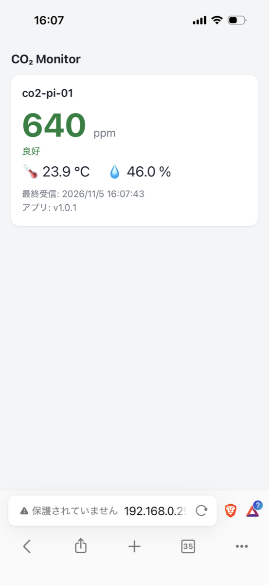
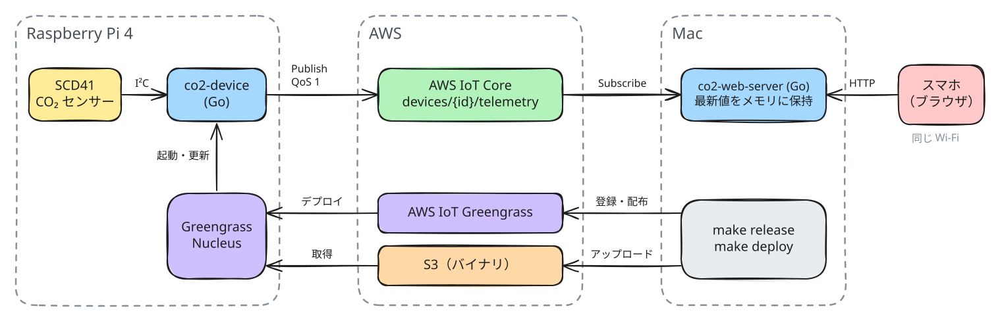
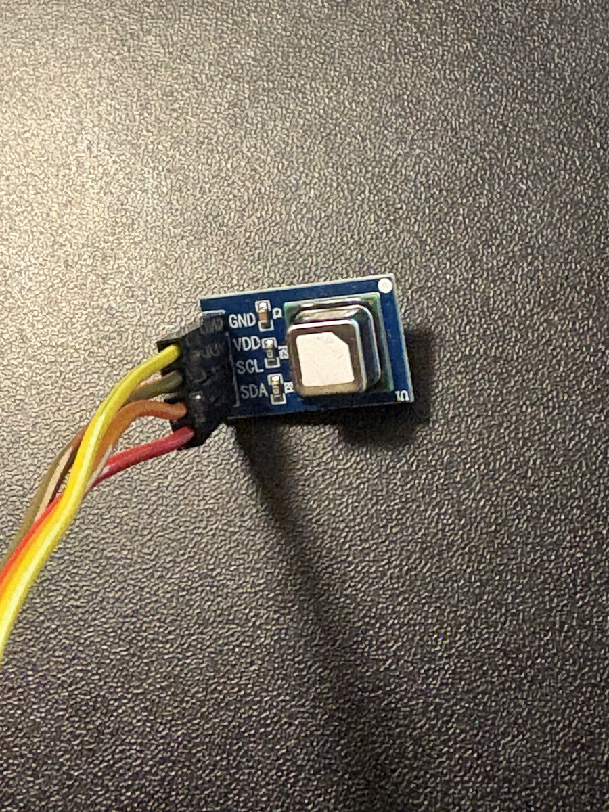
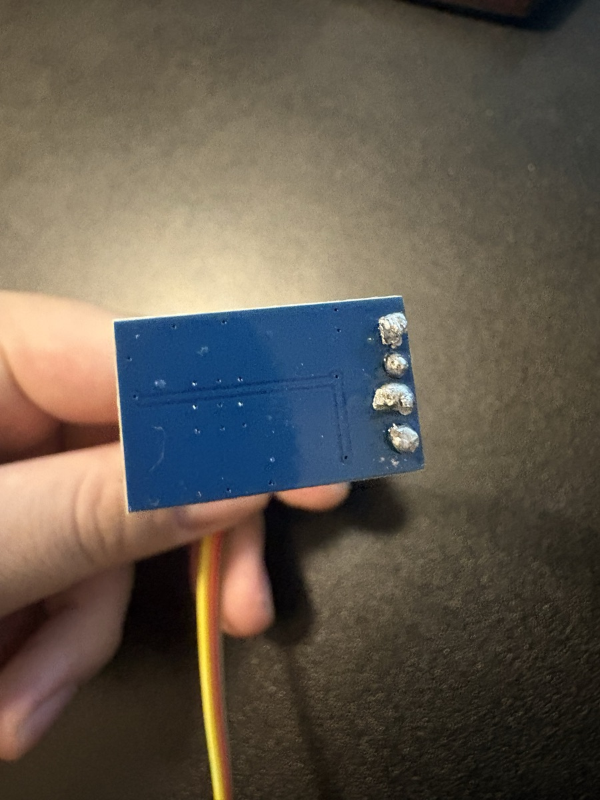
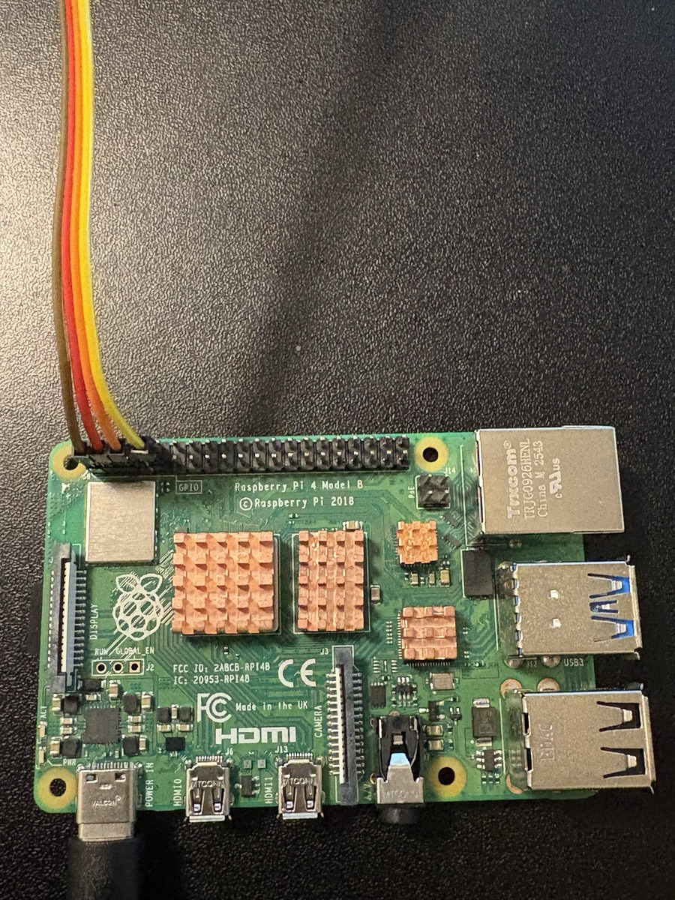
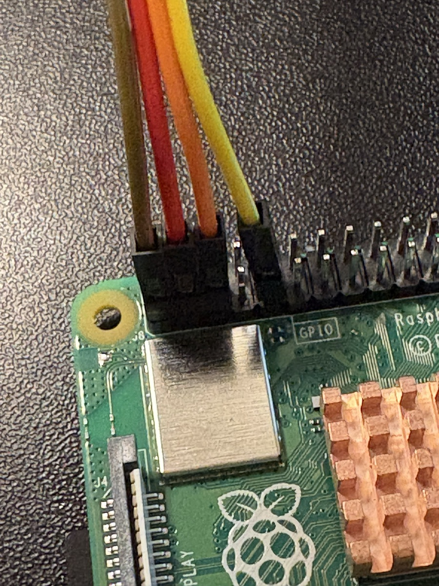
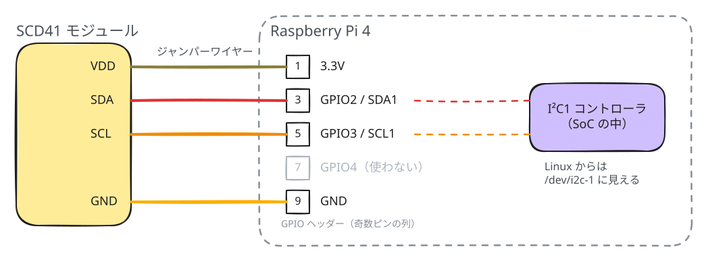
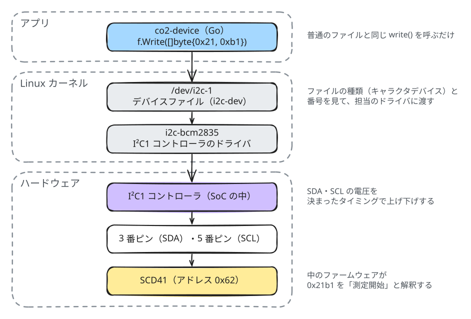
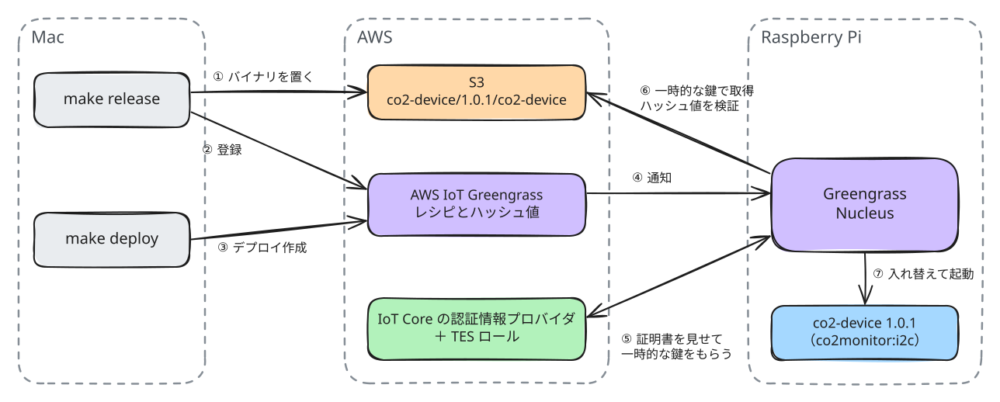

# co2-monitor

Raspberry Pi と CO₂ センサーで部屋の空気を測り、AWS IoT Core 経由でスマホに表示する。
ラズパイ上のアプリは AWS IoT Greengrass V2 で遠隔から配布・更新する。

センサーのはんだ付けから、I²C での通信、クラウドへの接続、遠隔配布までを一通り自分でやってみた記録。



## 1. 全体構成



- ラズパイのアプリが 5 秒ごとに CO₂・温度・湿度を測り、JSON を MQTT（QoS 1）で IoT Core に送る。
- Mac の表示サーバーがそれを Subscribe し、デバイスごとの最新値だけをメモリに持つ（DB なし）。
- スマホのブラウザは 3 秒ごとに API を取りにいく。30 秒届かないデバイスは「更新なし」と表示する。

```json
{"device_id":"co2-pi-01","measured_at":"2026-11-04T07:10:20Z","co2_ppm":605,
 "temperature_c":23.9,"humidity_pct":44.8,"app_version":"1.0.0","mock":false}
```

## 2. ラズパイとセンサーをつなぐ

センサーモジュールにピンヘッダーをはんだ付けし、ジャンパーワイヤーでラズパイの GPIO ヘッダーに挿した。

<p>
  
  
  
  
</p>



| センサー | 線の色 | ラズパイの物理ピン | ピンの役割 | 挿すとどうなるか |
|---|---|---|---|---|
| VDD | オリーブ | 1 | 3.3V | センサーに電源が入る |
| SDA | 赤 | 3 | GPIO2 / I²C1 の SDA | I²C のデータ線がつながる |
| SCL | オレンジ | 5 | GPIO3 / I²C1 の SCL | I²C のクロック線がつながる |
| GND | 黄 | 9 | GND | 電気の基準（0V）をそろえる |

3 番・5 番ピンは、ラズパイの SoC の中にある I²C1 コントローラにつながっている。
  OS で I²C を有効にすると、この 2 本が I²C 用に切り替わり、Linux からは `/dev/i2c-1` として見える。

## 3. センサーと通信する仕組み

3 番・5 番ピンにセンサーをつないだことで、`/dev/i2c-1` に書き込んだバイトが、I²C1 コントローラによって電圧の変化に変わり、センサーまで届くようになった。



### コマンドの送り方（`internal/sensor/scd41.go`）

SCD41 のコマンドは 2 バイト。[データシート](https://sensirion.com/products/catalog/SCD41)を読みながらドライバを自作した。

```go
f, _ := os.OpenFile("/dev/i2c-1", os.O_RDWR, 0)
unix.IoctlSetInt(int(f.Fd()), 0x0703, 0x62) // 以降の通信の宛先を 0x62 にする

f.Write([]byte{0x21, 0xb1}) // 定期測定を開始
f.Write([]byte{0xec, 0x05}) // 測定値をちょうだい
time.Sleep(time.Millisecond)
buf := make([]byte, 9)      // (値 2 バイト + CRC 1 バイト) × CO₂・温度・湿度
f.Read(buf)
```

## 4. systemd で動かす

最初は、Macでビルドしたバイナリを SSH で送り、systemd のサービスとして動かした。 バージョンはビルド時に埋め込み、画面に表示する。

```sh
GOOS=linux GOARCH=arm64 CGO_ENABLED=0 go build -ldflags "-X main.version=1.0.0" -o dist/co2-device ./cmd/device
```

以下のようなユニットファイルを作成し、systemd で動かした。
- root ではなく専用ユーザーで動かし、I²C に必要なグループだけを足す。
- 止めるとき systemd が送る SIGTERM を受けて、センサーの測定を止めてから終了する。

```ini
[Service]
User=co2monitor
SupplementaryGroups=i2c          # /dev/i2c-1 は i2c グループだけが読み書きできる
EnvironmentFile=/etc/co2-monitor/device.env
ExecStart=/opt/co2-monitor/co2-device
Restart=on-failure
```

ただし、この方法だと更新のたびに SSH でデバイスに入る必要がある。更新をクラウドから配れるようにし、デバイスで起きていることもクラウドから監視できるようにするため、Greengrass に移した。

## 5. Greengrass で管理・配布する

```
make release VERSION=1.0.1    ビルド → S3 にアップロード → コンポーネントとして登録
make deploy  VERSION=1.0.1    ラズパイに配る（Nucleus が S3 から取ってきて入れ替える）
make status                   ラズパイで動いているバージョンを見る
```



アプリは「コンポーネント」として、レシピに起動方法を書く。（systemd のユニットファイルにあたる）

```yaml
Lifecycle:
  run: |
    set -a; . /etc/co2-monitor/device.env; set +a
    exec {artifacts:path}/co2-device
Artifacts:
  - Uri: s3://<BUCKET>/co2-device/<VERSION>/co2-device
```
